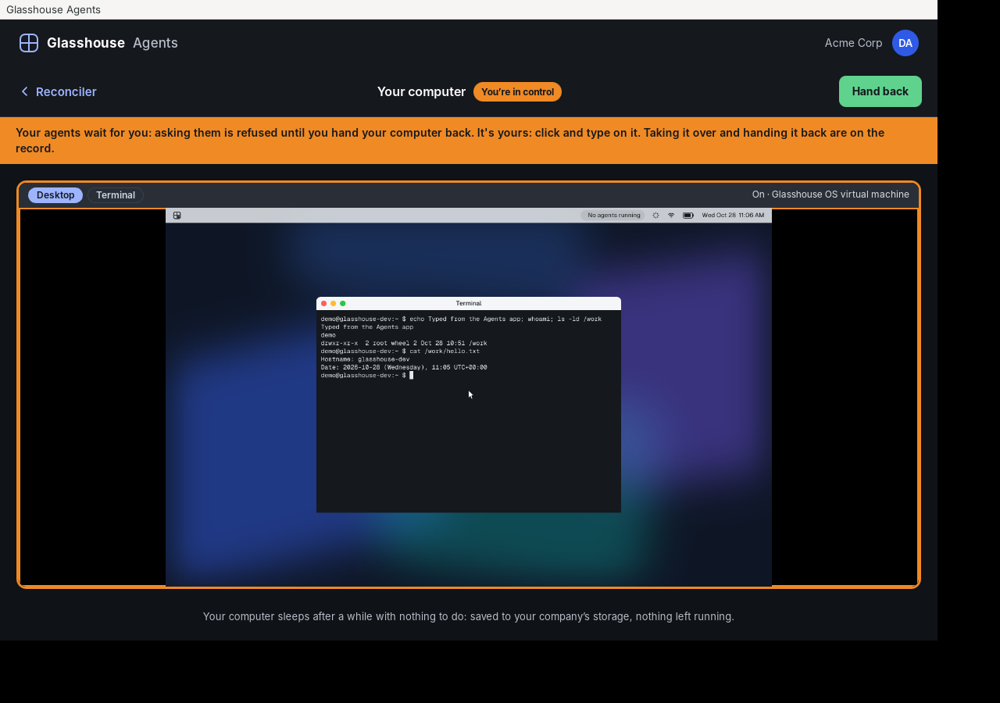
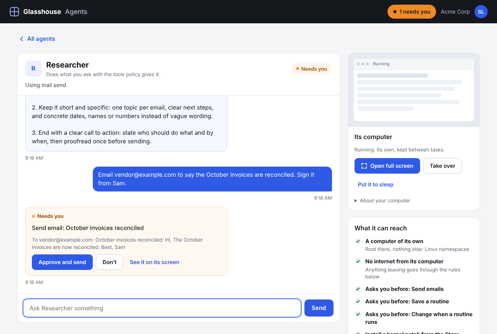
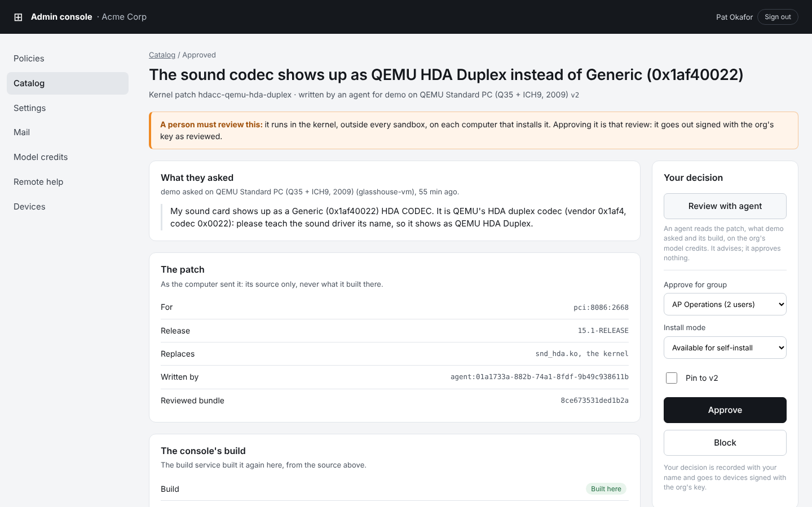

# Glasshouse

An operating system where people can safely hand real work to AI agents.
Every agent runs contained, and everything it does is visible, attributed,
on the record and undoable. Safety comes from the OS, not from the model
behaving well.

There are two products, built from the same core:

- **Glasshouse OS:** a desktop OS for company laptops, based on FreeBSD.
  Agents work beside the person, in sandboxes, under rules IT sets.
- **Glasshouse Agents:** the same agents in the cloud. Each person gets a
  computer of their own in their company's AWS account, which they manage
  from a web app, a desktop app, a CLI or Microsoft Teams.

*Glasshouse is a working name.* All rights reserved; see [LICENSE](LICENSE).

| | |
|---|---|
|  |  |
| Taking over a cloud computer that runs the whole Glasshouse OS desktop, in the Agents desktop app | An agent asks before it sends an email; the person approves or declines |



*IT reviews a kernel patch an agent wrote, in the admin console. All three
screenshots are from the development environment.*

## Status

**A working prototype, not yet in use anywhere.**
- Everything so far has run in an emulated FreeBSD VM and on development
  machines. No pilot laptop has booted the image yet.
- Glasshouse Agents has run against local stand-ins for AWS and Teams,
  never a real AWS account or Microsoft tenant.
- [docs/pilot-plan.md](docs/pilot-plan.md) ranks what stands between this
  and a first pilot.
- [docs/prd-traceability.md](docs/prd-traceability.md) gives every
  requirement's status and the test that proves it.

## What's built

### The core: how agents are kept safe
- **Containment.** Each task runs one agent in a jail of its own: no
  network, a read-only system, and only the folders it was given. A probe
  agent attacks the jail from inside on every end-to-end run.
- **Actions with tiers.** An agent changes nothing directly. It asks the OS
  to act (read a file, send an email), and IT's policy sets each action's
  tier: Auto, Notify, Ask or Never. Data labels decide what an agent may
  read and which model may see it.
- **Approvals.** An "Ask" waits for the person, approved once or for the
  rest of the task. Only the person the task is for can answer.
- **Undo.** ZFS snapshots are taken before changes. A task can be undone
  whole, back to a point in it, or change by change, and the OS says what
  can't be undone, such as a sent email.
- **The record.** A hash-chained audit log, written before an action runs,
  from which any task can be rebuilt end to end.
- **Models.** Every model call goes through `glassd`, which routes it by
  label and redacts secrets. The Anthropic API and Amazon Bedrock are
  supported, with prompt caching and tool use. Agents start on the
  cheapest model that will do, and work done the same way again becomes a
  script that runs without a model.

### Glasshouse OS
- **The desktop:** a native Rust shell (iced) with agent tiles, a command
  bar and a sign-in screen. Apps open in windows of their own, and native
  Terminal and Activity Monitor apps are included.
- **The apps:**
  - Mail (any IMAP and SMTP service), Calendar, Settings and a Store;
  - Chat, Meet, Docs, Sheets and Artifacts, sealed between the company's
    computers;
  - Routines, for the work that runs for you.

  Apps are web apps that the OS bounds by what their manifest declares.
  People can remix an app, or have an agent make a new one, and share it
  through the Store once IT approves it.
- **The admin console:** policy per group, device settings, signed releases
  in rings, remote help, model credits, and review of what agents wrote.
  So far it runs in development mode only.
- **The system:**
  - built on FreeBSD 15.1 from package lists;
  - signed OS updates installed into boot environments;
  - a read-only system, checked at every start;
  - Wi-Fi, Bluetooth, sleep and screen brightness;
  - a hardware report for a laptop;
  - hardware fixes as kernel patches that agents write and IT reviews,
    tried in a boot environment of their own.

### Glasshouse Agents (the AWS product)
- **Everything runs in the buyer's own AWS account,** from a CloudFormation
  stack, with Marketplace metering.
- **One computer per person,** which their agents share as personas. It
  sleeps to S3 when idle and wakes on any host. Each person reaches only
  their own.
- **The ways in:**
  - a web app;
  - a desktop app (the web app in a native window, with tray and
    notifications);
  - the `glass` CLI, which signs in through the browser;
  - approval cards in Microsoft Teams.
- **Taking over a computer** that runs the full Glasshouse OS desktop: the
  person watches it live, then drives it with their own mouse and keyboard.
- **Schedules** run while a computer sleeps.
- **IT turns apps off** for agents too.

### Designed, not built yet
- Shared hosts where many of a company's people each have a session, and
  agents run as the person
  ([ADR 0073](docs/adr/0073-pooled-hosts-agents-run-as-the-person.md)).
- Moving files to and from agents under IT's rules
  ([ADR 0074](docs/adr/0074-files-in-and-out-under-its-rules.md)).
- Microsoft 365 mail, calendar and Teams chat, with agents working as their
  person or as an identity of their own
  ([ADR 0075](docs/adr/0075-microsoft-365-agents-for-you-or-their-own.md)).

### How it's checked
- **Tests at every level:**
  - unit tests;
  - the full runtime tested on a development machine;
  - an end-to-end suite in the FreeBSD VM;
  - Playwright tests of the web apps and the admin console;
  - time budgets for anything a person waits on.
- **Models of key workflows in TLA+** (`make tla`): boot, policy, the audit
  log, containment, approvals, undo, OS updates, kernel patches, chat, mail
  and more. TLC checks them, and they found bugs that were then fixed.
- **Other checks:**
  - a soak test that runs agents for hours through crashes;
  - a matrix of emulated hardware;
  - license checks on every dependency.

## Getting started

You need a Linux x86_64 machine (Ubuntu 24.04 is what's tested) with
about 15 GB free and 8 GB of memory. The Rust toolchain is pinned in
`rust-toolchain.toml`, and the web apps need Node 22.18 or later. KVM
makes the VM fast, but isn't required. Docker is optional (for the local
AWS stand-ins). Full details are in
[docs/dev/test-environment.md](docs/dev/test-environment.md).

```sh
make help                 # every target, one line each
make check                # type-check everything, fastest feedback
make test lint            # unit and integration tests, formatting, clippy, layering
```

### Glasshouse OS, in a VM
```sh
make test-env             # tools, the FreeBSD 15.1 image, the VM, build and deploy (~5 min)
make e2e-vm               # the end-to-end suite in the VM (~2 min)
make greeter-vm           # the sign-in screen on the VM's display (password: demo)
os/freebsd/scripts/vm.sh screendump shot.png   # see what the VM's screen shows
```

Then, in the VM (`make vm-ssh`, then `su demo`):

```sh
glassctl run invoice-demo "Reconcile invoices and remind vendors" --read ~/Invoices --write ~/Reports
glassctl watch                 # live tiles
glassctl approve <id>          # the vendor reminders wait for you
glassctl show <task>           # activity, changes, what it couldn't touch, timeline
glassctl undo <task>           # put it all back (sent mail stays sent)
glassctl run it-agent "My disk is filling up" --yes
glassctl run containment-probe "Try to escape"
```

### Without a VM (development only, no containment)
```sh
make dev-host             # glassd on this machine, with the insecure host sandbox
make apps-dev             # the apps at http://mail.localhost:7300
make console-dev          # the admin console at http://127.0.0.1:7400
```

### Glasshouse Agents
```sh
make agents-dev           # glassd with agent computers and the web app at http://127.0.0.1:7500
make agents-app-deps agents-app   # the desktop app (Linux needs WebKitGTK)
make aws-local aws-local-test     # S3, KMS, metering and sign-in, simulated on this machine
```

Agents use a scripted model by default, so nothing leaves the machine. To
run them on Claude, set `GLASS_AGENTS_MODEL=anthropic` and put your key in
`GLASS_ANTHROPIC_API_KEY`.

## Where to look

| | |
|---|---|
| [docs/architecture.md](docs/architecture.md) | How it fits together: processes, a task's life, containment, undo, audit |
| [docs/repo-layout.md](docs/repo-layout.md) | Where code goes, the layering rules, conventions |
| [docs/adr/](docs/adr/README.md) | Every decision and why, numbered |
| [docs/prd/](docs/prd/README.md) and [docs/prd-traceability.md](docs/prd-traceability.md) | The product requirements, and each one's status and test |
| [docs/pilot-plan.md](docs/pilot-plan.md) | What stands between this and a pilot |
| [docs/design/](docs/design/README.md) | The mockups, and the API behind each element |
| [docs/dev/](docs/dev/) | The test environment, testing, performance budgets, build speed, hardware, dependencies |
| [shell/README.md](shell/README.md) | The desktop shell (its own Cargo workspace) |
| [apps/README.md](apps/README.md) | The web apps, the Agents web app and the admin console's front end |
| [agents-app/README.md](agents-app/README.md) | The Glasshouse Agents desktop app |
| [deploy/aws/README.md](deploy/aws/README.md) | The stack a buyer deploys on AWS |
| [os/freebsd/README.md](os/freebsd/README.md) | The OS image, the VM and cross-compiling |
| [specs/tla/README.md](specs/tla/README.md) | The TLA+ models, and the code each one covers |

### The code
| | |
|---|---|
| `crates/lib`, `crates/svc`, `crates/apps`, `crates/bin` | The Rust workspace, in layers that only depend downward. `glassd` is the one privileged daemon; `glassctl` and `glass` are the CLIs. |
| `shell/` | The desktop: shell, sign-in screen, compositor, native apps |
| `apps/` | The web apps (TypeScript) |
| `agents-app/` | The Agents desktop app (Rust, wry and tao) |
| `os/freebsd/` | The image, its overlay, and the VM and build scripts |
| `deploy/` | The AWS stack, and the local stand-ins for it |
| `specs/tla/` | Models of key workflows |
| `tests/` | End-to-end, hardware, soak, update and local-AWS suites |
| `tools/` | Development scripts: screenshots, branding, legal notices, performance |

## How it's built

Glasshouse is developed with [Claude Code](https://claude.ai/code).
[CLAUDE.md](CLAUDE.md) and [.claude/skills/](.claude/skills/) hold the
project's conventions and the workflows that repeat, such as testing by
hand with screenshots and reviewing containment changes.
