# Design: the agent window mockups

The PRD's mockups live in a Claude Design canvas, **"Agent Window — OS
Mockups"**: <https://claude.ai/artifact/Y5fH2vFk3fWUvWumZTRATC>. The PNGs here
are renders of its twenty-two artboards, for reading without the canvas. They go
stale when the canvas changes; re-render them with the `prd-sync` skill
(`.claude/skills/prd-sync`), which uses `tools/design/render-dc.py`.

The desktop is **Mac-like** (DK-1, revised): a translucent menu bar across
the top, a dock at the bottom, window controls on the left, agent tiles at
the top right, and the command bar opening over everything with Ctrl Space.
The shell's first screens exist: `shell/` renders the Desktop, Sign in,
Boot, Command bar and Expanded boards from `glass-api` data (`make
shell-preview`; `SOCKET=` for a live glassd's tiles), and `glass-shell-fb`
shows them on the VM's console framebuffer with live tiles and input (ADR
0016). The compositor is not built. Everything a tile, the
expanded view and the handoff card show already comes from the control API
(`glass-api`), so the shell can be built directly against it. The tables
below say which field drives each element, and what's still missing.

Design tokens from the canvas: Geist and Geist Mono; dark tiles `#15181D` on a
light desktop; accent `#3D6BFF` for working and you're-driving; attention
`#F08A24` for needs-you, the only state that pulses; 44 px touch targets.

## Desktop · agent tiles

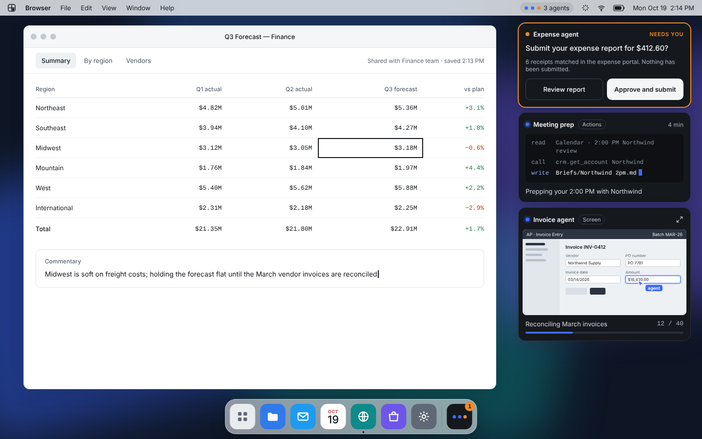

| Element | Source |
|---|---|
| One tile per running agent, needs-you on top (AW-1) | `task.list` → `TaskView`; sort by `state == NeedsYou`. **Tiles don't stay on screen** (product decision, 2026-10-19): a new agent, an ask or an ending shows as a banner at the top right for 4 s (an ask 7 s), like a macOS notification, then goes; with the pointer on it, it stays until the pointer leaves (then 2 s more); approving or opening it takes it away at once. The stack the artboard shows lives in the **agents menu** (below) |
| Agents menu: every agent, needs-you first, "3 running · 1 needs you" | The menu bar's agents pill opens it (`Message::ToggleAgents`); a tile opens its expanded view; a click outside or Esc closes it. `screens::desktop::Tiles::Menu`, `live::Live` |
| Name and mode chip ("Actions", "Screen") | `agent_name`, `mode` |
| Elapsed ("4 min") | now − `started_at` |
| Feed: verb column + target (AW-3) | `feed[].verb`, `feed[].target` (`text` is the whole line) |
| Caption and "12 / 40" (AW-4) | `caption`, `progress` (agents call `report_progress`) |
| Needs-you question, Review drafts / Approve and send | `needs: ApprovalView` (`summary`, `items`; `labels` are the action's own answer words, `ActionDef.ask`, "Review" and "Approve" by default) → `approval.answer` |
| "Allow sends for the rest of this task" | `ApprovalAnswer::Approve { scope: Task }` |
| Screen thumbnail with labeled agent cursor (AW-2) | **Not built**: needs screen-control agents |
| Menu bar: app menus, "3 agents" pill with one dot per tile (a button: it opens the agents menu), Wi-Fi, battery, clock | `task.list` counts and states; app menus come from the focused app (shell), and with none focused the left side is only the mark (product decision, 2026-10-18: the desktop isn't an app). The mark opens the system menu: "Hand an agent a task…" (Ctrl Space, the command bar) and "Sign out <name>…"; apps join it when they have windows. Wi-Fi and battery from the system (PM, CF) |
| Dock: launcher, apps with open dots, calendar date, Agents with a needs-you badge | Apps from the catalog (shell); the badge is the count of `NeedsYou` tiles |
| Command bar over everything, Ctrl Space (DA-1) | `task.plan` on enter; see Command bar below |
| Live updates | `events.subscribe` → `event` notifications (`TaskUpdated`, `TaskRemoved`) |

## Expanded · watch, take over, rewind

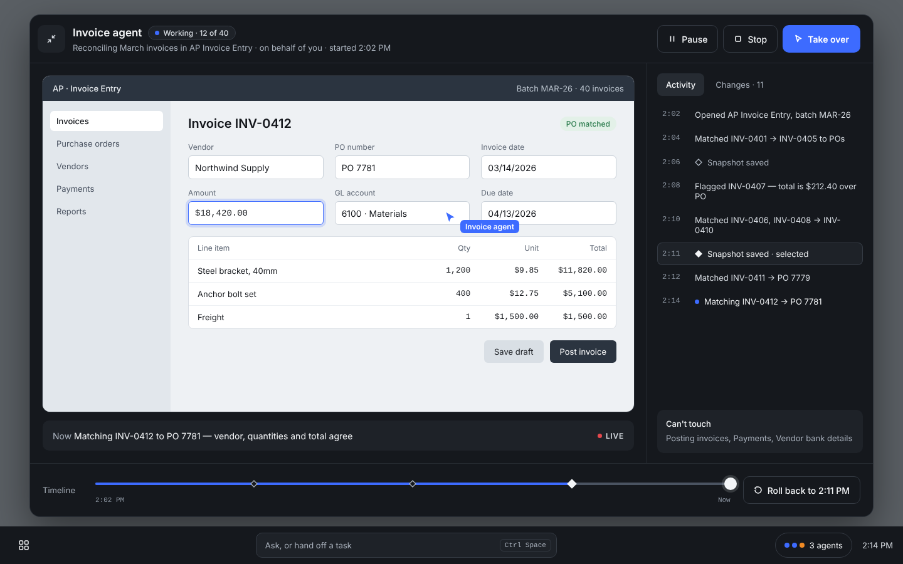

The shell draws this board (`shell/crates/glass-shell/src/screens/expanded.rs`;
`make shell-preview` writes `expanded.png` and its Changes, roll back,
review and receipt variants). Clicking a tile, or a needs-you tile's Review,
opens it over the desktop with one `task.get`; the tiles tuck away and keep
updating, and the agent becomes the menu bar's app.

| Element | Source |
|---|---|
| Collapse button, Esc (AW-16) | Shell: back to the tiles; the agent carries on. Esc first closes the command bar or a roll back card |
| Header: name, "Working · 12 of 40", "on behalf of you · started 2:02 PM" | The tile's `TaskView`, current to the last event (`agent_name`, `state`, `progress`, `caption`, `started_at`; "finished 2:41 PM" from `updated_at` once ended) |
| Pause / Stop / Take over (AW-11, AW-20) | `task.pause`, `task.stop`, `task.take_over`. Only what applies to the `TileState`: Resume (`task.resume`) while paused, Hand back (`task.hand_back`) while you drive, none once the task ended; Take over is off for a task the person's own harness drives (`driver_socket`) |
| Left pane: live screen with agent cursor, LIVE badge (AW-12) | **Not built**: screen-control agents. Until then the left pane shows what the person needs from the data: the ask's items with its own answer and Decline while `NeedsYou` (`needs.items`, `labels`, `rule`; `approval.answer`), the receipt once ended (`receipt`, `failure`), otherwise the feed (`feed[]`), the request (`prompt`) and the `plan` |
| Now bar (AW-12) | `TaskDetail.now` |
| Activity tab with snapshot rows (AW-13) | `activity[]`, newest at the bottom; `kind == Snapshot` rows are ◇, the one Roll back returns to ◆; clicking one picks it. The latest 200 lines are drawn |
| Changes · 11 | `changes[]`: "Can't be undone" for `reversible: false`, "Undone" for `undone` |
| Can't touch (AW-14) | `cant_touch[]` |
| Timeline markers, "Roll back to 2:11 PM" (AW-15) | `snapshots[]`, placed by time from `started_at` to now; the latest is picked unless the person picks another. Roll back asks `task.undo { to, dry_run: true }` and shows `restored`, `removed` and `not_undone`; confirming sends `task.undo { to }` and shows what it did |
| Kept current | A `TaskUpdated` event for the open task updates the header at once and fetches `task.get` again for the rest |
| "Stop asks once if unsaved work" (AW-11) | **Not built**: needs the agent to report unsaved, un-snapshotted work |

## Tile states

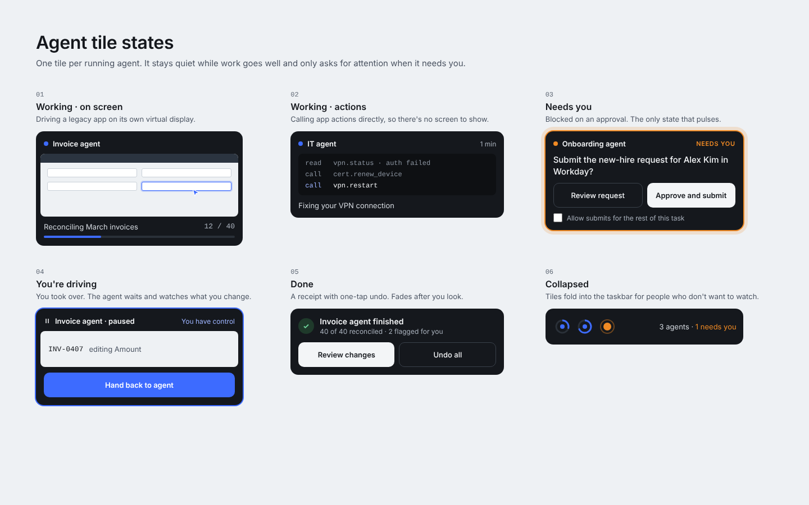

| Artboard state | `TileState` |
|---|---|
| Working · on screen / Working · actions | `Working` (`mode` picks thumbnail or feed) |
| Needs you | `NeedsYou` with `needs` set |
| You're driving · "You have control" · Hand back | `YouAreDriving` → `task.hand_back` |
| Done: receipt, Review changes, Undo all | `Done` with `receipt`; Undo all → `task.undo` |
| Collapsed | A shell display mode, not a task state |
| Failed (mocked in [Calm notifications](#calm-notifications--failed-agent)) | `Failed` with `failure` and `receipt` |
| Paused, Paused for sleep (PM-5) | `Paused`; caption "Paused for sleep" while the machine sleeps. **Needs a mock.** |

## Handoff · plan and scope

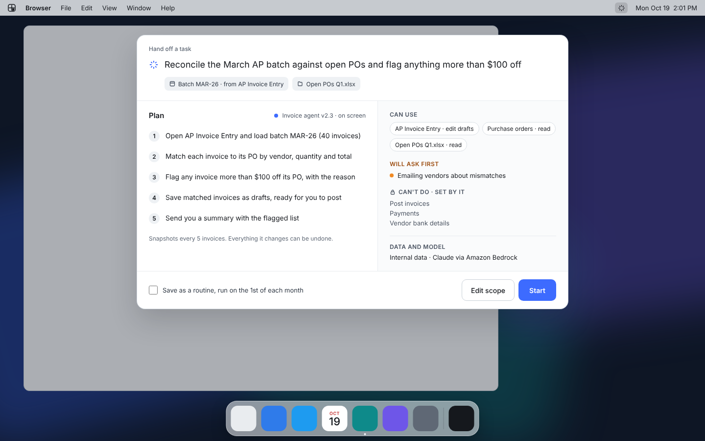

| Element | Source |
|---|---|
| Task text and context chips (DA-1) | `TaskRequest.prompt`, `scope.read/write` |
| Plan, 3–7 steps; "Invoice agent v2.3 · on screen" | `HandoffCard.plan`, `agent.version`, `agent.mode` |
| Can use | `touches[]` (path + access) |
| Will ask first | `asks_before[]` |
| Can't do · set by IT | `cant_touch[]`: IT's Never rules by name, plus data, network and scope limits |
| Data and model | `max_label`, `model` |
| Edit scope (DA-3) | re-plan with `scope.restrict` (stricter only) |
| Start | `task.start` |
| "Snapshots every 5 invoices" | **Partial**: snapshots before every change and Notify step; no cadence yet (AU-20) |
| Save as a routine (DA-4, P1) | **Not built** |

## Admin · agent policy

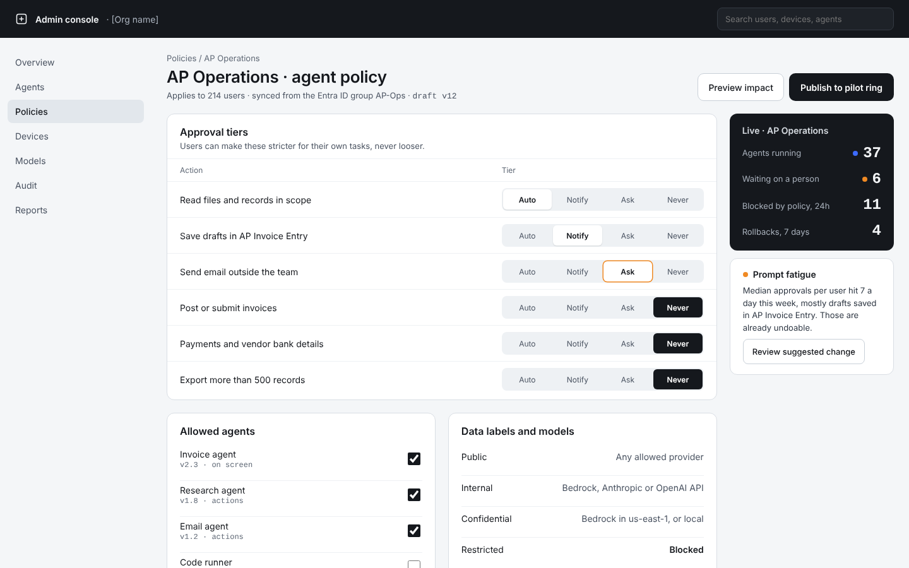

The admin console is not started. Today its content lives in `policy.toml`
(`glassctl policy default` prints the shipped one):

| Element | Today |
|---|---|
| Approval tiers per action, "stricter, never looser" | `[org.tiers]`, `[group.tiers]`, `[agent.tiers]`; users only tighten (DA-10) |
| Plain-language action names | `[names]` |
| Allowed agents per group | `[[group]] agents` |
| Data labels and models | `max_label` rules; model routing waits for the gateway |
| Preview impact, publish to pilot ring (AD-3) | **Not built** |
| Live stats: running, waiting, blocked 24h, rollbacks 7d (AD-4) | **Not built**; the audit log has the data |
| Prompt fatigue nudge (DA-14, P1) | **Not built** |

## Changes and undo

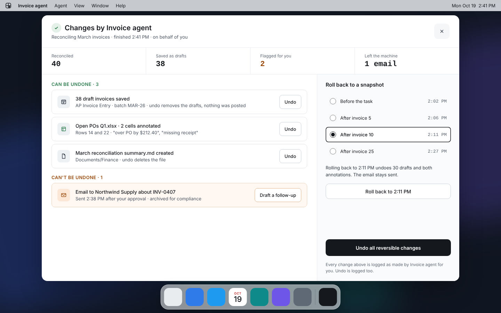

Built on `task.get` and `task.undo`. Verified on real ZFS snapshots by the
e2e `changes` scenario.

| Element | Source |
|---|---|
| "Changes by Invoice agent", "finished 2:41 PM · on behalf of you" | `TaskDetail.view` (`agent_name`, `updated_at`, `user`) |
| Counts: Reconciled 40, Flagged for you 2 | `progress`, `receipt.flagged` |
| Left the machine: 1 email | `receipt.left_machine` |
| Saved as drafts: 38 | **Not built**: counts in the agent's own terms need an agent-reported outcome (`report_progress` carries only a caption, numbers and a title today) |
| Can be undone · 3 / Can't be undone · 1 | `changes[]` split on `reversible` (and `undone`) |
| One row for "38 draft invoices saved" | The shell groups `changes[]` by `action`; Undo on the row sends all their ids |
| Per-row Undo | `task.undo { changes: [id, …] }`; `dry_run` first. Puts back just the files those changes wrote (`ChangeEntry.paths`) |
| Draft a follow-up (on a change that can't be undone) | **Not built**: a new task with the sent message as context (compensating actions are P2) |
| Roll back to a snapshot, with "undoes 30 drafts and both annotations. The email stays sent." | `snapshots[]` → `task.undo { to, dry_run: true }` gives `removed`, `restored`, `not_undone` |
| Undo all reversible changes | `task.undo {}` |
| "Undo is logged too" | Every rollback is a `Rollback` audit event with the change ids and files |

## Calm notifications · failed agent

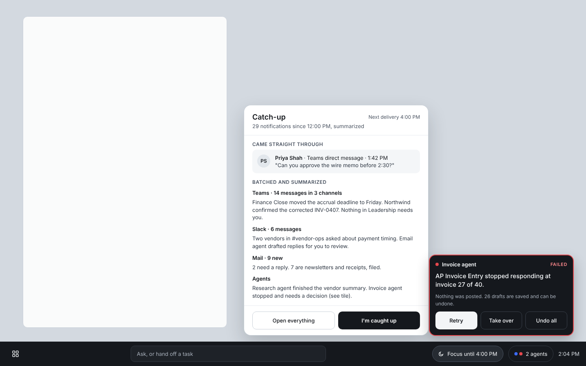

| Element | Source |
|---|---|
| Failed tile: "stopped responding at invoice 27 of 40" | `state == Failed`, `failure`, `progress` |
| "Nothing was posted. 26 drafts are saved and can be undone." | `receipt.outcome()`: "Nothing left the machine. 26 changes can be undone." (`left_machine`, `undoable`) |
| Retry | `task.retry` → a new task with the same request and scope, checked against today's policy. Only the task's own user can retry it. |
| Take over | For screen agents, the agent's display (not built). For an actions agent that ended: `task.continue` starts the task again in the user's own Claude Code, which is told what the agent did and why it stopped; `TaskView.driver_socket` is what to connect (`glass-mcp <socket>`), and hand back closes it (ADR 0015) |
| Undo all | `task.undo {}` |
| Catch-up panel, batched and summarized notifications, Focus until 4:00 PM (CF-71, P1) | **Not built**: a notification service in the shell; agents' tile events are one of its sources |
| Menu bar "2 agents" with one red dot | `task.list` states |

## First-run setup · AI models

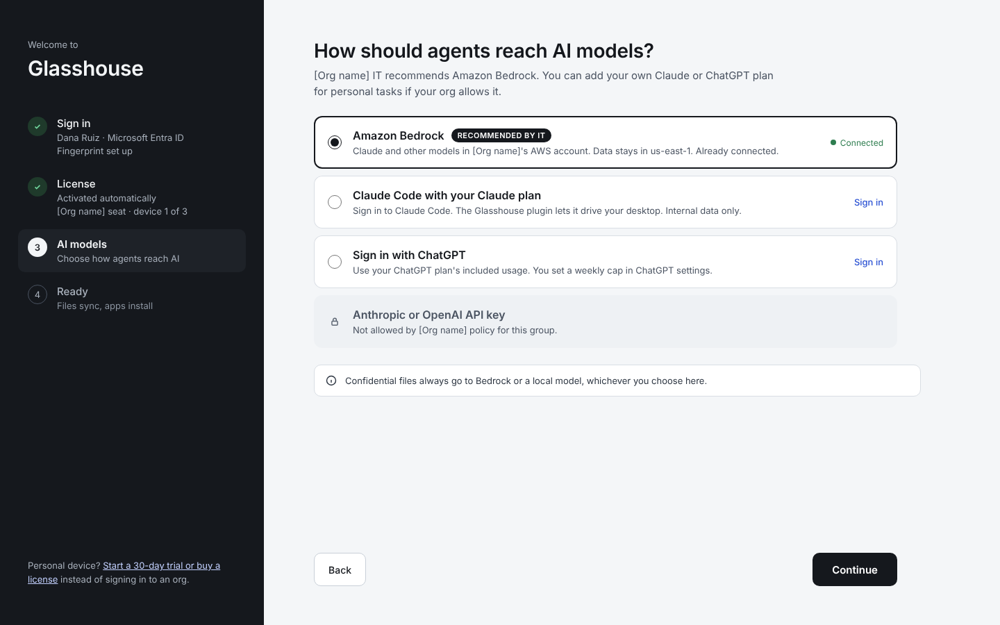

Not built. Each step maps to a P0 area:

| Element | Requirement |
|---|---|
| Sign in with Microsoft Entra ID, fingerprint | CF-1 … CF-3 |
| License activated automatically, "device 1 of 3", personal trial | LA-1 … LA-3, LA-10 … LA-12 |
| Amazon Bedrock (recommended by IT, already connected); Claude Code with your Claude plan; ChatGPT; API keys blocked by policy | MP-1 … MP-9, HX-1 (Claude Code plugin) |
| "Confidential files always go to Bedrock or a local model" | DP-1, DP-10: the gateway routes by label. The handoff card's `model` line is where a user sees the result per task |
| Ready: files sync, apps install | CF-40, DV-10 |

## Remote help desk session

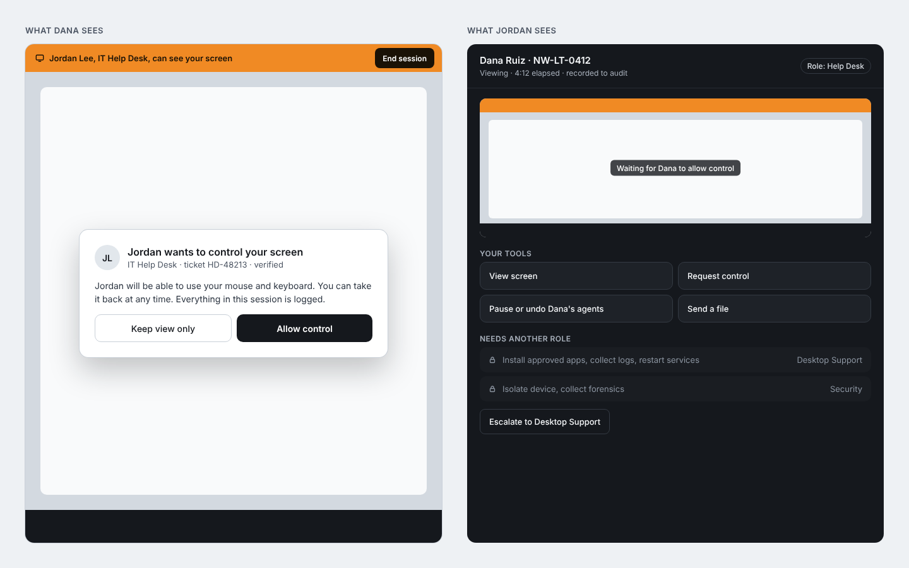

Not built (CF-80 … CF-82 are P0; CF-83 is P1). What exists that it builds on:

| Element | Today |
|---|---|
| Banner "can see your screen", Allow control / Keep view only, End session | Needs the compositor's consent-gated capture (UI-2) |
| Tools by directory role (Help Desk, Desktop Support, Security) | Roles from Entra/Okta groups (AD-1); not modeled yet |
| "Pause or undo Dana's agents" (CF-83) | `task.pause`, `task.undo` already work for root. A support role needs its own authorization, under the user's consent, instead of root |
| "Recorded to audit" | The audit log; sessions would be new event kinds |

## Security investigation

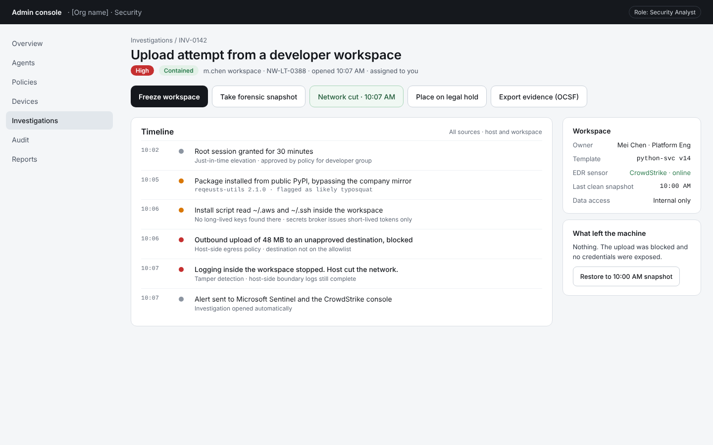

Not built: the admin console (AD-1) and the developer workspace (DW-*).
What exists that it builds on:

| Element | Today |
|---|---|
| Timeline from all sources | The hash-chained audit log; `audit.task` rebuilds one task |
| Export evidence (OCSF) | **Not built** (EP-7, AU-2) |
| Take forensic snapshot, Restore to 10:00 AM snapshot | ZFS snapshots (`glass-platform::snapshot`); remote rollback is EP-6 |
| Network cut, host-side egress policy | Agent jails have no network at all today; per-destination egress (pf) comes with the model gateway |
| Freeze workspace, legal hold | **Not built** (DW-*, CF-64) |
| Alert to Sentinel and CrowdStrike | **Not built** (EP-7) |

## IT agent · fixing a VPN

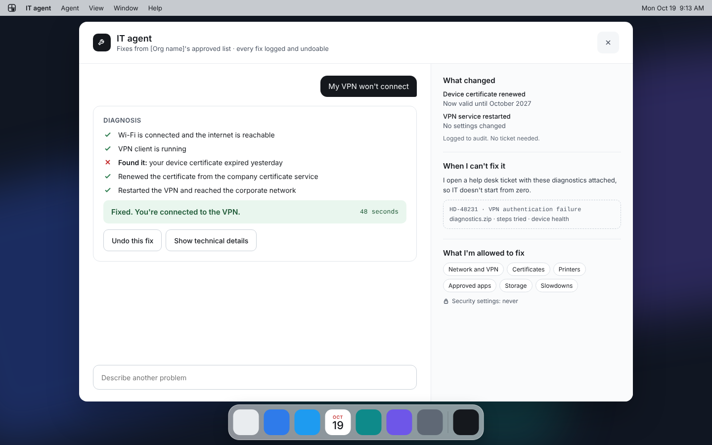

The IT self-service agent (AE-4). Its first slice is built: `glass-it-agent`
(scripted until model-backed agents land) using the `system.*` and
`helpdesk.*` actions (ADR 0012). Verified in the VM by the e2e `it` scenario.

| Element | Source |
|---|---|
| "My VPN won't connect" | `TaskRequest.prompt` to `it-agent` (the command bar will route there, AE-3) |
| Diagnosis lines, ✓ and ✗ | `system.network.check`, `system.storage.check`, `system.performance.check`: each returns `findings[]` and `healthy` in its structured result; the agent narrates them as captions |
| Restarted the VPN | `system.service.restart` (Ask), only for services on IT's list (policy `[fixes] services`, e.g. `openvpn`) and set up on this machine |
| "Found it: certificate expired", "Renewed the certificate" | **Not built**: certificate actions need the company certificate service (SCEP, CF-10) |
| Fixed, 48 seconds | Done tile, `receipt`; elapsed from `started_at` and `updated_at` |
| Undo this fix | `task.undo { changes: [id] }`. A cache cleanup comes back from its snapshot; a restart leaves nothing to undo |
| What changed | `changes[]` (cleanups); restarts are in `activity[]` and the audit log |
| When I can't fix it: HD-48231 with diagnostics | `helpdesk.ticket.create` (Ask) with the checks' results attached. Tickets go to a root-only outbox until the ServiceNow adapter lands |
| What I'm allowed to fix | The agent's `allowed_actions` (`system.*`, `helpdesk.ticket.create`) and IT's `[fixes]` list; the handoff card shows them. Certificates, printers and approved app installs: **not built** |
| Security settings: never | `security.*` is Never in org policy, and no system action touches them |

## Expense agent · portal and policy check

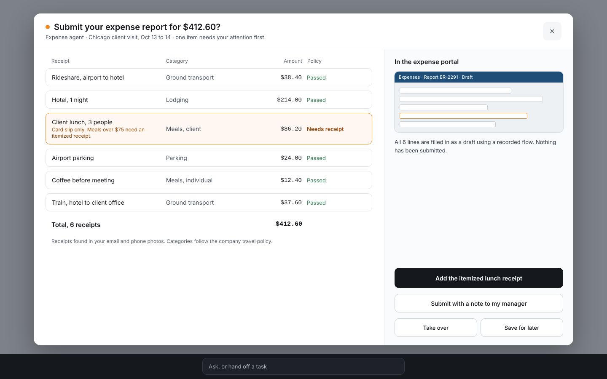

| Element | Source |
|---|---|
| "Submit your expense report for $412.60?" with the receipt list | A batched Ask: `ApprovalView.summary` and `items` (DA-12) |
| Policy column, "Needs receipt" | The agent's own findings, shown in the review list. Company travel policy as a checkable source: **not built** |
| Filled in "using a recorded flow", portal thumbnail | **Not built**: screen control and recorded flows (NV-20, NV-21) |
| Take over, Save for later | `task.take_over`; Save for later is `task.pause` |

## Onboarding agent · across systems

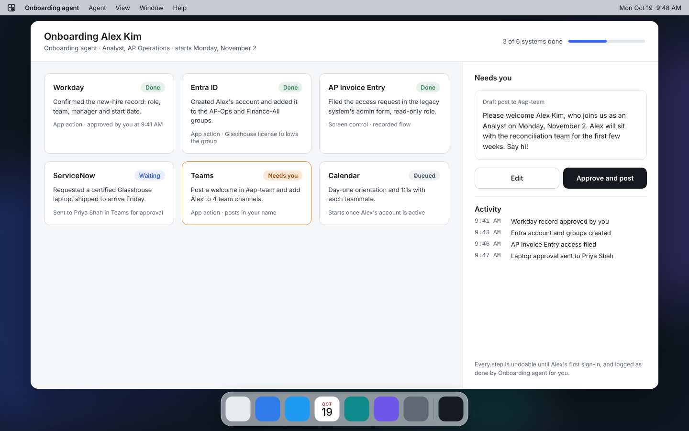

| Element | Source |
|---|---|
| "3 of 6 systems done" | `progress` |
| Per-system cards: Done, Waiting, Needs you, Queued | **Gap**: the plan is a list of strings (`TaskDetail.plan`). Steps with their own state, owner and how they ran (app action, screen control) need a typed plan |
| Draft post to #ap-team, Edit, Approve and post | An Ask with the draft as its item; editing a draft before approving is **not built** |
| "Every step is undoable until Alex's first sign-in" | Compensating actions in other systems (P2); local undo works today |
| Workday, Entra ID, ServiceNow, Teams | Adapters (DV catalog, HX): **not built** |

## Command bar · general desktop agent

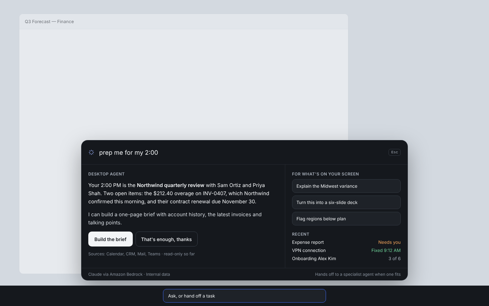

The general desktop agent (AE-3) is the default for anything typed here. It
opens over everything with Ctrl Space, like Spotlight (DK-1).

| Element | Source |
|---|---|
| "prep me for my 2:00" and the answer | **Not built**: AE-3 needs the model gateway and harness bundles (ADR 0010). Today `glassctl run <agent>` names the agent |
| "Hands off to a specialist agent when one fits" | **Gap**: routing a request to an agent. `agents.list` has what the router needs (ids, descriptions) |
| Suggestions for what's on screen | **Not built**: needs the shell and the accessibility tree (NV-11) |
| Recent: Expense report, Needs you, Fixed 9:12 AM, 3 of 6 | `task.list`: `title` (given with the request, or made from the prompt; the agent may rename it once), `state`, `progress`. A done verb in the agent's terms ("Fixed") is a **gap**: Recent says "Done" |
| "Claude via Amazon Bedrock · Internal data" | `HandoffCard.model` and `max_label` |

## Developer workspace

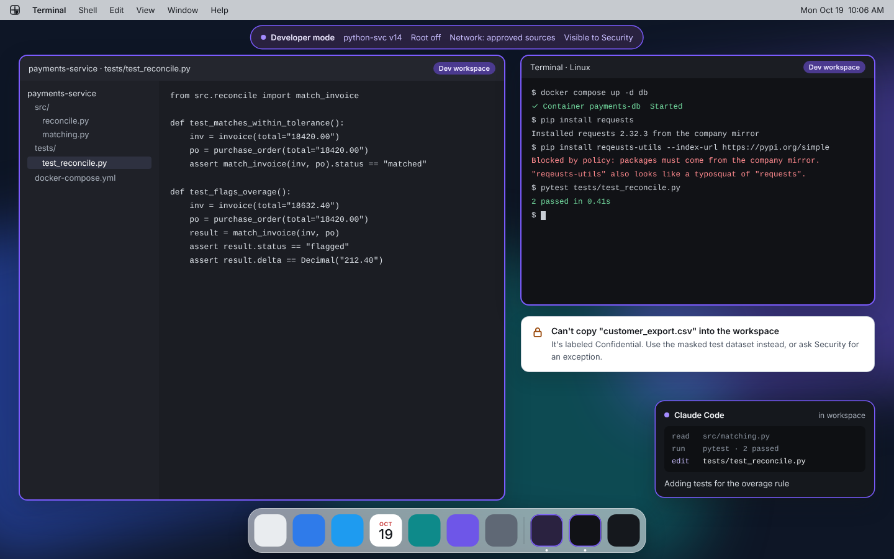

Not built (DW-1 … DW-26). What it builds on: data labels already block
Confidential reads for agents (the "can't copy customer_export.csv" banner is
the same rule, DP-10); package-mirror enforcement is egress policy (EP-2).
Claude Code in the workspace is HX-1.

## Catalog · approving an agent

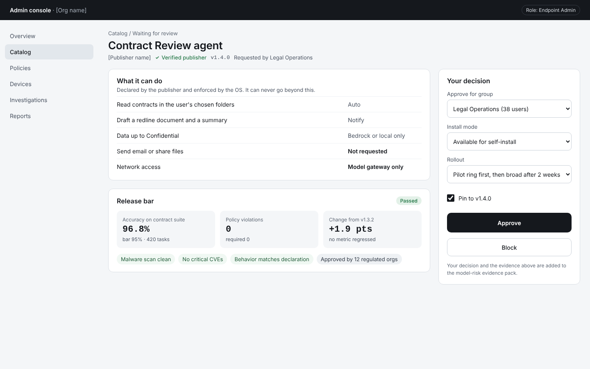

| Element | Source |
|---|---|
| What it can do: declared by the publisher, enforced by the OS | The signed manifest (ADR 0008); today the closest thing is `[[agent]] allowed_actions` in policy |
| Release bar: accuracy, policy violations, change from the last version | Eval suites and the release bar (AE-10, AE-11, ADR 0010): **not built** |
| Approve for group, install mode, rollout ring, pin version | Today: `[[group]] agents` in policy. Rings and pinning are the console's (AD-3, DV-12) |

## Tailoring a catalog agent

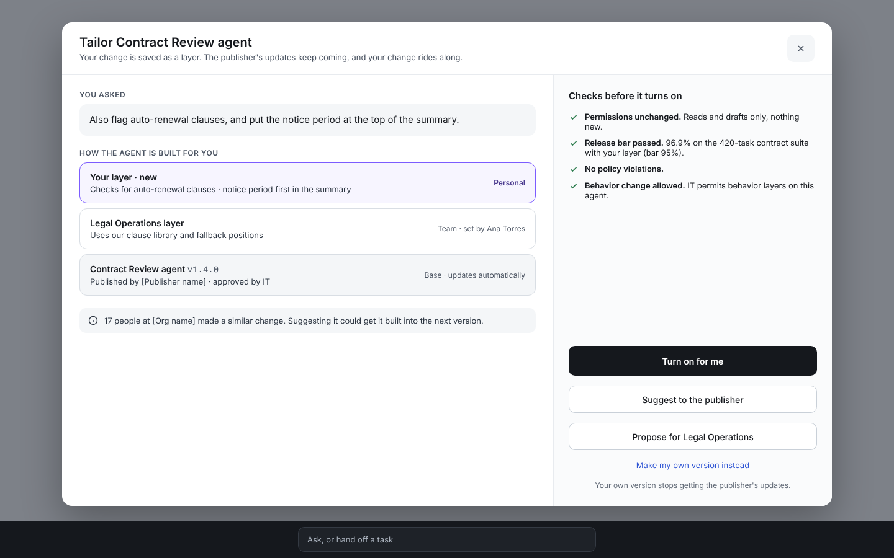

Personal layers are built (ADR 0014); try them with `glassctl tailor
invoice-demo`. The Contract Review agent itself doesn't exist; the invoice
demo agent declares the customization points.

| Element | Source |
|---|---|
| "You asked: Also flag auto-renewal clauses…" | `LayerChange.note`, kept per version (`LayerVersion.note`). Turning a sentence into settings needs the desktop agent (AE-3); today the user sets them (`settings`, `restrict`) |
| How the agent is built for you: your layer, team layer, base version | `LayerView.active`, `history[].summary`; the base is `LayerView.agent` (name, version). Team layers (TL-3): **not built** |
| "Personal" chip | Every layer is personal today |
| Base · updates automatically | The layer sits on whatever version the catalog has; a new version re-checks it (TL-13) |
| Checks before it turns on | `LayerView.checks[]` (`name`, `result`, `detail`): "Only what the publisher lets you change" (TL-1), "Permissions only narrow" (TL-10), "Release bar" (TL-11, reports `not_available` until eval suites exist) |
| "Behavior change allowed. IT permits behavior layers on this agent" | TL-12: **not built** |
| Turn on for me | `layer.set` (saves a version and turns it on after the checks pass) |
| Undo / earlier versions | `layer.revert { to }`; `to: null` turns the layer off |
| "17 people made a similar change", Suggest to the publisher, Propose for Legal Operations | TL-20 … TL-22, TL-3: **not built** |
| Make my own version instead | TL-4: **not built** (a copy becomes a generated app, GA) |
| A paused layer | `LayerStatus::Paused { reason }`; the handoff card's `layer.paused` |

## Apps built on request · vendor disputes

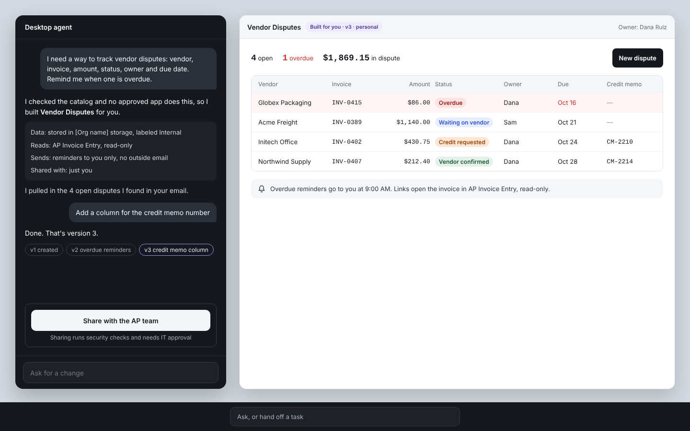

Not built (GA-1 … GA-11, P1). What it builds on:

| Element | Source |
|---|---|
| "I checked the catalog and no approved app does this" | Catalog first (GA-2): needs the catalog service; `agents.list` is the local stand-in for agents |
| Data, reads, sends, shared with | Would be the generated app's manifest, enforced like any app's: declared actions join the registry (ADR 0013), tiers and labels from policy |
| "Built for you · v3 · personal", v1 / v2 / v3 chips | Versioned like layers (ADR 0014), each version undoable (GA-3) |
| Overdue reminders to you only | An action at Auto for the owner and Ask for anyone else; sends outside follow the tiers (GA-7) |
| Owner: Dana Ruiz | GA-9 ownership; the audit log already attributes every change to a user |
| Share with the AP team: security checks and IT approval | GA-8 sharing steps, reusing the catalog checks (DV-2, DV-3) |

## Boot

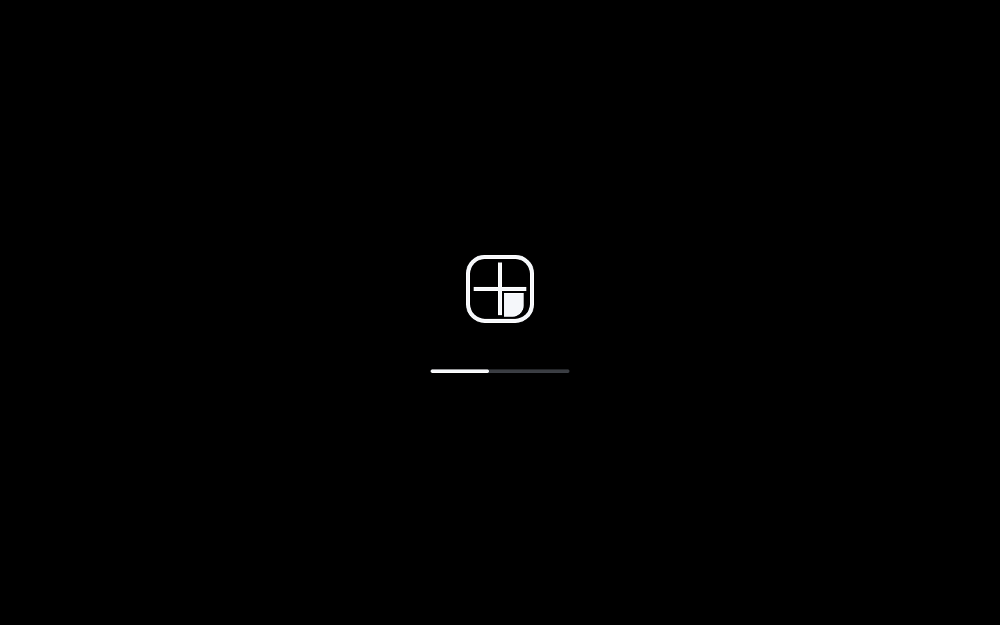

Black, the four-pane Glasshouse mark and a progress bar. The mark replaces
the house art: `tools/branding/art.py` draws it for the boot splash, the
boot menu and the console screens. A static splash can't move its bar, so the
splash shows the mark alone; the shell draws the bar once it starts (M2).

## Sign in

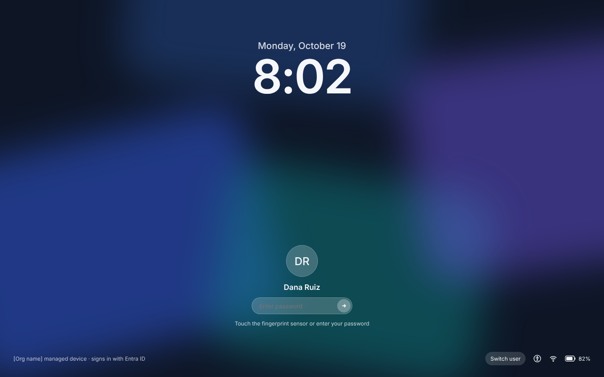

| Element | Source |
|---|---|
| Date and large clock on the wallpaper | Shell (lock screen, UI-4) |
| Avatar, name, password field, "Touch the fingerprint sensor" | The greeter, signing in through PAM (**not built**); fingerprint and passkeys are CF-2 (**not built**) |
| "[Org name] managed device · signs in with Entra ID" | Enrollment and directory sign-in (AD-1, **not built**) |
| Switch user, accessibility, Wi-Fi, battery | Shell; accessibility through AccessKit (UI-4) |

Until the greeter exists, the console login screen (`/etc/issue`) carries
the mark and the agent status line.

## Snapping and ask the agent

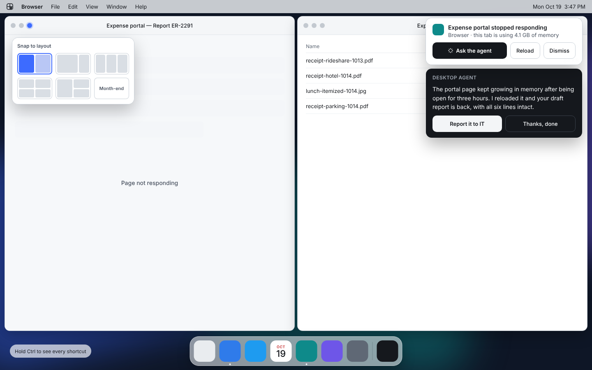

| Element | Source |
|---|---|
| Snap to layout picker: halves, thirds, quarters, saved "Month-end" (UX-21) | Compositor window management (**not built**) |
| "Expense portal stopped responding" with Ask the agent / Reload / Dismiss (UX-30) | A system notification; Ask the agent starts a desktop-agent task (`task.start`) with the crash details as its prompt and IT's diagnostics actions in scope (AE-4's `system.*`) |
| Desktop agent's answer, Report it to IT / Thanks, done | The task's caption and receipt; Report it to IT is `helpdesk.ticket.create` |
| "Hold Ctrl to see every shortcut" (UX-20) | Shell (**not built**) |

## Themes

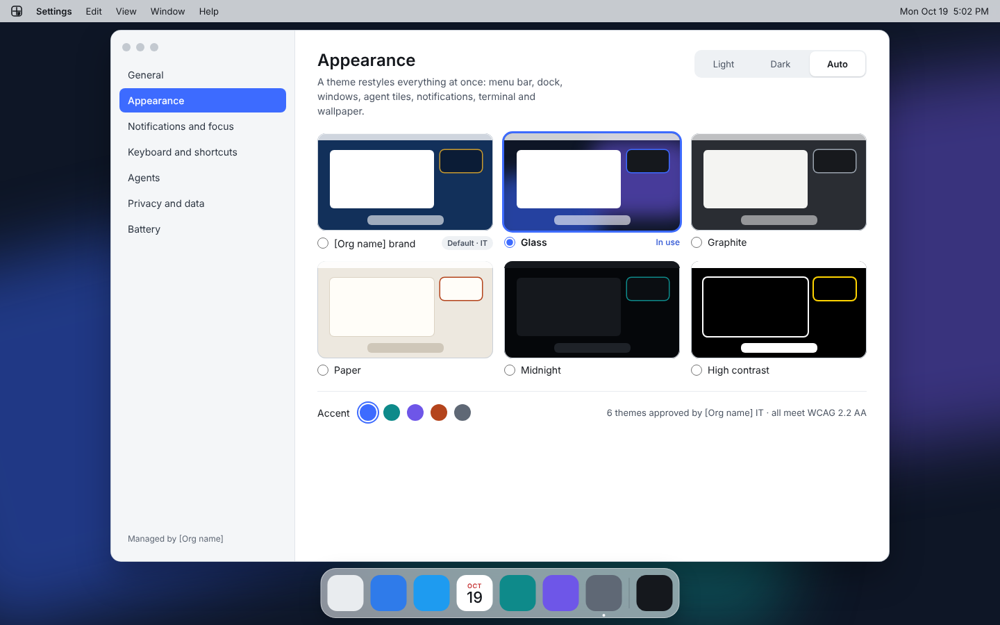

| Element | Source |
|---|---|
| One theme restyles menu bar, dock, windows, tiles, notifications, terminal and wallpaper (UX-10) | The shell reads one theme (tokens: colors, radii, wallpaper); the first shell crate keeps every color in one `Theme` |
| Light / Dark / Auto | Theme modes |
| "[Org name] brand · Default · IT", "6 themes approved by IT", WCAG 2.2 AA (UX-11) | Policy: an org theme and an allow list (**not built**) |
| Accent colors | Theme tokens |

